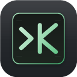
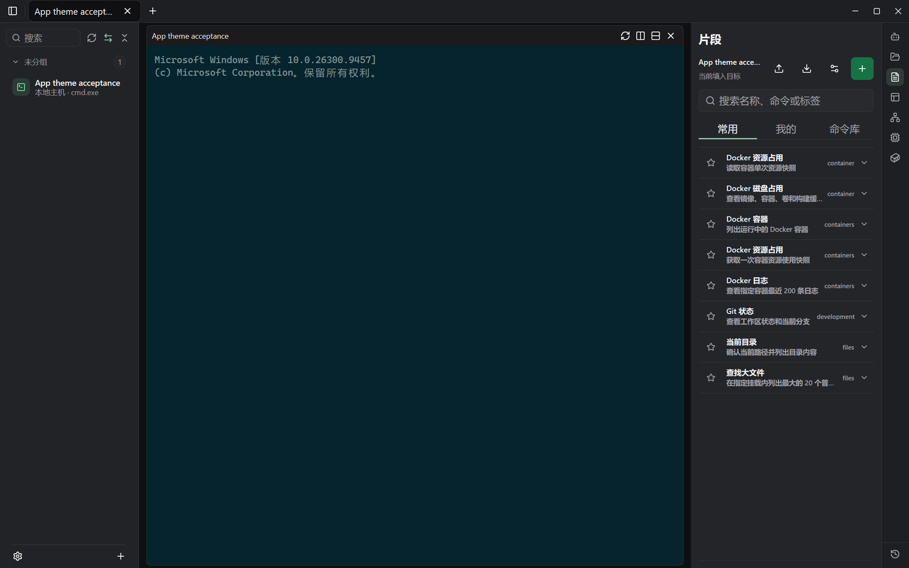
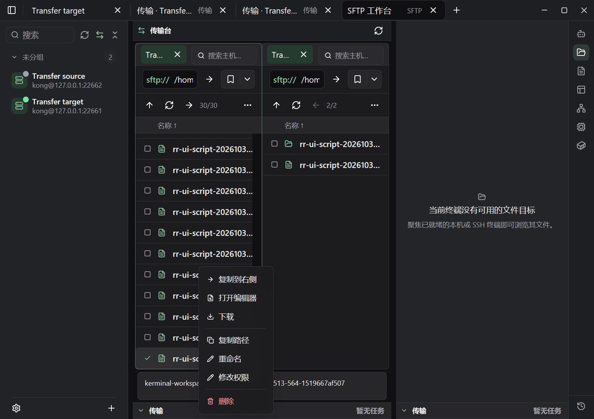
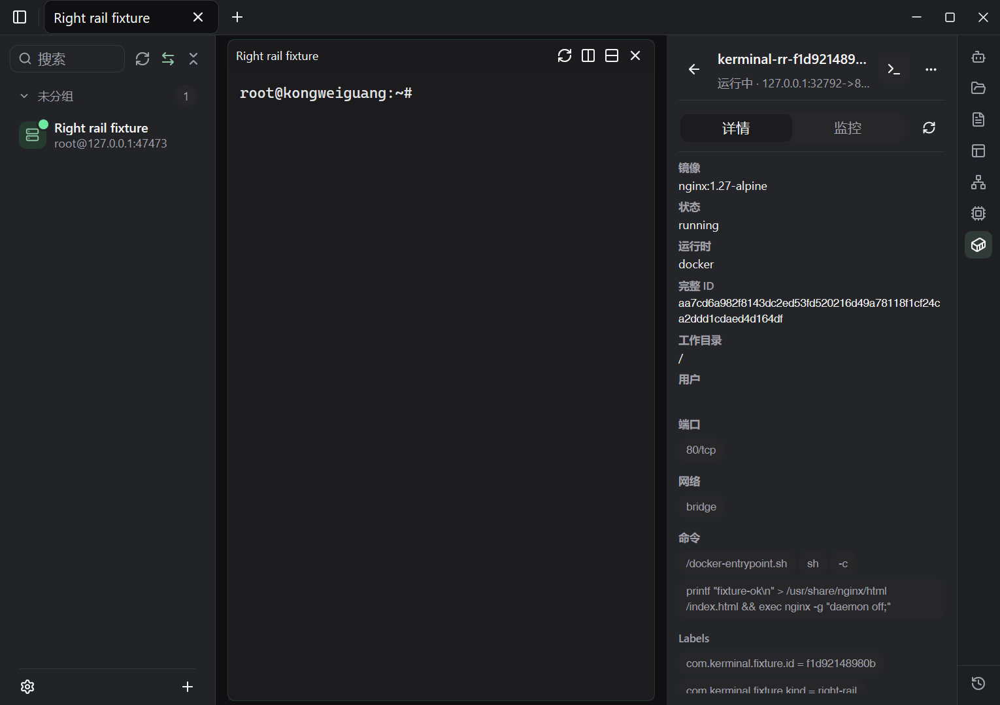
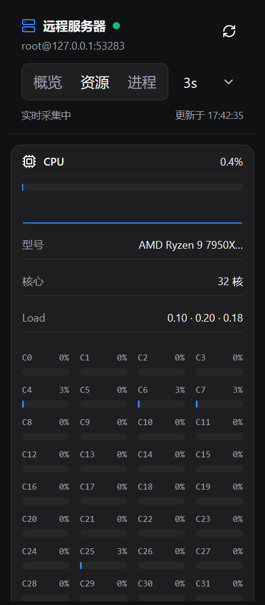
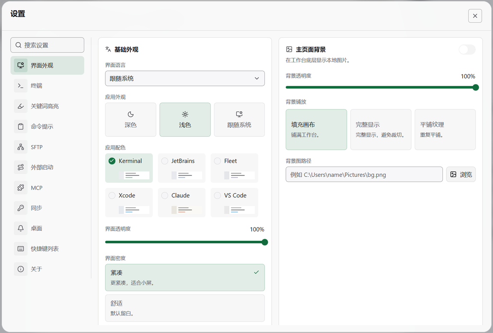

<!-- @author kongweiguang -->

<div align="center">
  
  <h1>Kerminal</h1>
  <p><strong>A native desktop terminal workspace for local development and remote operations</strong></p>
  <p>Split terminals · SSH / SFTP · Container and server tools · AI agents · Plugins</p>
  <p>
    <a href="https://github.com/kongweiguang/Kerminal/releases/latest">Download</a> ·
    <a href="#quick-start">Quick start</a> ·
    <a href="#upgrading-from-03x">Upgrade from 0.3.x</a> ·
    <a href="README.md">简体中文</a>
  </p>
</div>



Organize hosts on the left, work across local and remote sessions in the center, and open files, containers, tunnels, or an agent from the tool rail. Kerminal 0.4 is built with Rust, GPUI, and GPUI Kit and ships packages for Windows, Linux, and macOS. Screenshots show development builds with demo data. Controls may vary by version.

## Download and install

**v0.4.0** is the first stable release of the native GPUI desktop app. See the [v0.4.0 release](https://github.com/kongweiguang/Kerminal/releases/tag/v0.4.0) for release notes and checksums, or browse [all releases](https://github.com/kongweiguang/Kerminal/releases).

| Platform | v0.4.0 packages |
| --- | --- |
| Windows x64 | [NSIS installer](https://github.com/kongweiguang/Kerminal/releases/download/v0.4.0/windows-x86_64-kerminal_0.4.0_x64-setup.exe) for the current user |
| Linux x64 | [AppImage](https://github.com/kongweiguang/Kerminal/releases/download/v0.4.0/linux-x86_64-kerminal_0.4.0_x86_64.AppImage) · [DEB](https://github.com/kongweiguang/Kerminal/releases/download/v0.4.0/linux-x86_64-kerminal_0.4.0_amd64.deb) |
| macOS | [Apple Silicon DMG](https://github.com/kongweiguang/Kerminal/releases/download/v0.4.0/macos-aarch64-Kerminal_0.4.0_aarch64.dmg) · [Intel DMG](https://github.com/kongweiguang/Kerminal/releases/download/v0.4.0/macos-x86_64-Kerminal_0.4.0_x64.dmg) |

Windows packages lack Authenticode signatures and macOS packages lack Apple notarization, so the OS may show a warning. Verify your download against [SHA256SUMS.json](https://github.com/kongweiguang/Kerminal/releases/download/v0.4.0/SHA256SUMS.json). Linux requires host graphics libraries, and the DEB requires glibc 2.35 or later. Installation and desktop interaction on macOS still await testing on a Mac.

## Quick start

1. **Open a terminal.** Use `+` in the title bar to open your default local shell, or add a connection at the bottom of the host sidebar. Single-click selects a host. Double-click or press `Enter` to open a new session.
2. **Work side by side.** Split the terminal right or down from its header. Right-click a split button to choose another host for the new pane. Group, rename, collapse, and drag tabs to organize your sessions.
3. **Open files and remote tools.** Use the tool rail for the active session's files, containers, and server information. Open the dual-pane SFTP workspace from the host sidebar to select a source and destination. Right-click the tool rail to reorder tools or dock them on the left, right, or bottom, or float them in the workspace.
4. **Run an agent next to your terminal.** Open the Agent tool, select a launcher, and enter the session. Install the CLI and complete its sign-in or model setup first.

## Features

| Area | What you can do |
| --- | --- |
| Local and remote connections | Open local shells, SSH, standalone SFTP, Telnet, and serial sessions. Launch RDP in your platform client. SSH supports passwords, private keys, SSH agents, proxies, and ordered jump hosts. |
| Terminal sessions | Use tabs, nested splits, reconnect, search, command blocks, suggestions, history, and snippets with variables. Select the destination panes before broadcasting input. |
| Files and transfers | Browse session files from the sidebar, copy between local and remote endpoints in the dual-pane workspace, or keep separate transfer tabs. Track progress, cancel or retry transfers, and resolve conflicts. Edit local, SFTP, and container text files in the built-in editor. |
| Containers and servers | Manage Docker, Podman, and Compose on SSH hosts. Inspect containers, check logs and stats, open a shell, or browse container files. View server resources and processes, manage local or SSH tmux sessions, and set up local, remote, or SOCKS SSH forwarding. |
| Appearance and configuration | Choose light, dark, or system appearance and separate app and terminal palettes. Use shell profiles, custom shortcuts, TOML configuration, an encrypted vault, and Git configuration sync. See the [configuration guide](crates/application/resources/config-guide.md). |

Remote features depend on the connection type, tools installed on the host, and account permissions.

<details>
<summary>See the SFTP, container, server, and settings screens</summary>

| Dual-pane SFTP | Container details |
| --- | --- |
|  |  |

| Server resources | Light appearance settings |
| --- | --- |
|  |  |

</details>

## AI agents and MCP

Run **Codex, Claude Code, PI Agent, or a custom CLI** from the Agent tool. Each workspace tab retains its agent panel and session history. Agents can use the entire Kerminal workspace. The terminal selected at launch is their preferred target, and switching tabs leaves that binding in place. Built-in Codex and Claude Code launch in full-access mode by default.

External clients can find the active endpoint in MCP settings. The default Streamable HTTP endpoint is `http://127.0.0.1:37657/mcp`. Call `kerminal.help` for guidance and `tools/list` for the live tool list. Create background PTYs without opening a visible tab, run SSH commands, manage SFTP transfers and port forwarding, or query command history. The MCP client host manages permissions, approvals, and audit. Keep optional LAN access on a trusted network because the HTTP transport is unencrypted. [MCP tool definitions](crates/kerminal-mcp/resources/tool_catalog.json)

## Plugins

Manage built-in features and external plugins in Extensions settings. Plugins can contribute host types, workspace views, sidebar tools, settings, and commands. Installation, updates, and enablement changes take effect after restart. Enable plugins from trusted sources only. Sidecars run with the current user's privileges. [Plugin catalog](https://github.com/kongweiguang/Kerminal/releases/tag/plugins-catalog-v1) · [Developer examples](sdk/examples/README.md)

## Upgrading from 0.3.x

1. **Quit 0.3.x completely, including the tray process, and back up its data directory.** The 0.4 installer uses the same product identity and may replace the old installation.
2. Install and launch the 0.4 stable release. It uses `~/.kerminal` by default and checks, backs up, and migrates supported legacy data on first launch. It preserves the original files and reports any corrupt or unsupported data it finds.
3. Keep the migration backup under `.kerminal-migration/`. The old app cannot read migrated data. GPUI development builds and betas use `~/.kerminal-gpui` separately. Stable releases do not import that data automatically.

To check a backup copy before migrating, use the scripts in the installer's `migration/` resource directory. On Windows use `kerminal-migrate.ps1` with `-Root` and `-DryRun`. On Linux and macOS use `kerminal-migrate.sh` with `--root` and `--dry-run`. The 0.3.x source is available on the [`tauri` branch](https://github.com/kongweiguang/Kerminal/tree/tauri).

## Build from source

Use the pinned [Rust toolchain](rust-toolchain.toml). Windows needs MSVC C++ Build Tools and the Windows SDK. Linux needs native graphics, font, and system development libraries. See the [native release workflow](.github/workflows/gpui-release.yml) for platform dependencies.

```bash
git clone https://github.com/kongweiguang/Kerminal.git
cd Kerminal
cargo xtask run
```

You can also run `cargo run -p kerminal-desktop`. Development builds use `~/.kerminal-gpui` by default. Set `KERMINAL_CONFIG_ROOT` to use a separate directory. Run `cargo xtask ci` for the workspace checks or `cargo xtask smoke` for a native smoke run with isolated data. Source code lives in [`crates/`](crates/) and package configuration in [`packaging/`](packaging/).

## License

Kerminal is licensed under **GPL-3.0-or-later**. [License](LICENSE) · [Third-party notices](THIRD_PARTY_NOTICES.md)
