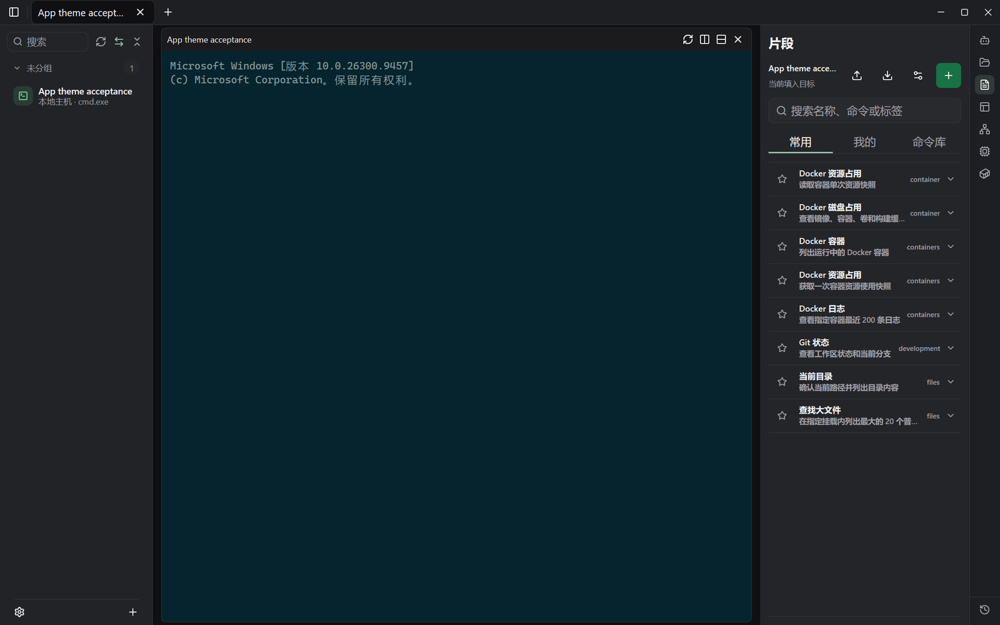
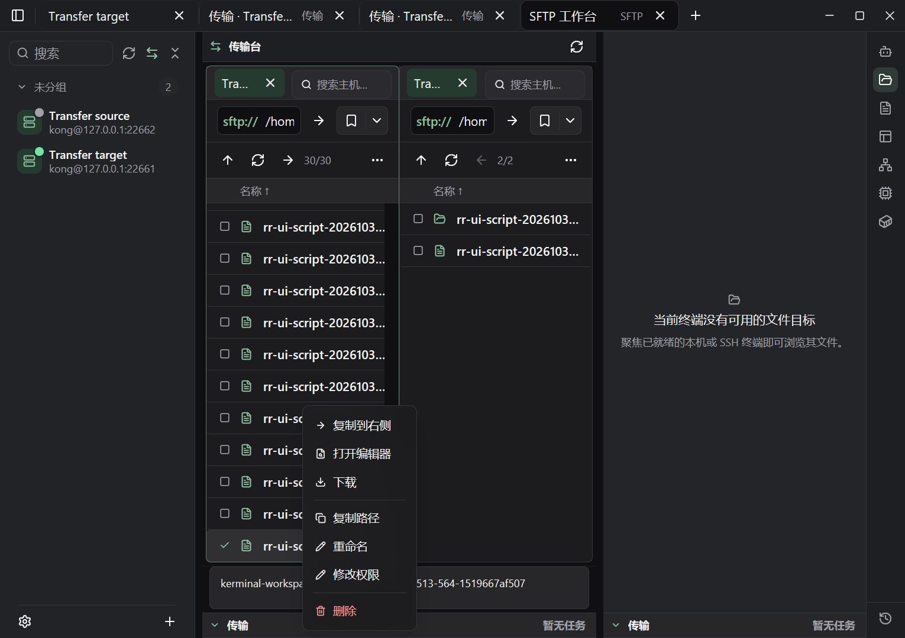
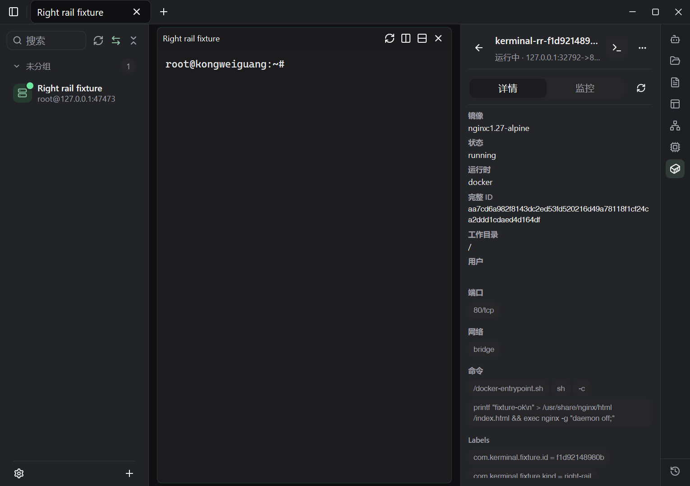
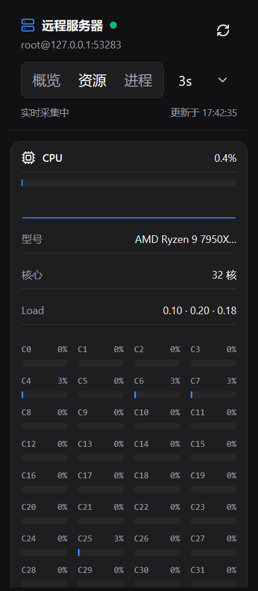
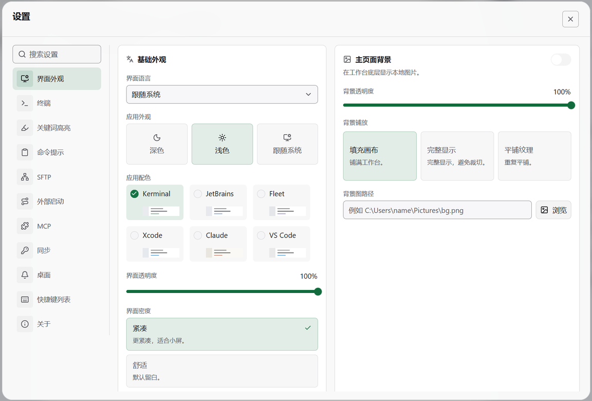

<!-- @author kongweiguang -->

<div align="center">
  
  <h1>Kerminal</h1>
  <p><strong>面向本机开发和远程运维的原生桌面终端工作台</strong></p>
  <p>分屏终端 · SSH / SFTP · 容器与服务器工具 · AI Agent · 插件</p>
  <p>
    <a href="https://github.com/kongweiguang/Kerminal/releases/latest">下载最新版</a> ·
    <a href="#五分钟上手">快速开始</a> ·
    <a href="#从-03x-升级">从 0.3.x 升级</a> ·
    <a href="README.en.md">English</a>
  </p>
</div>



在左侧管理主机与分组，在中间用标签和分屏并行操作本机与远程会话，从右侧打开文件、容器、隧道或 Agent。Kerminal 0.4 使用 Rust、GPUI 和 GPUI Kit 构建桌面工作台，提供 Windows、Linux 和 macOS 安装包。截图来自 GPUI 开发版的演示环境，具体控件以所安装版本为准。

## 下载与安装

**v0.4.0** 是原生 GPUI 版的首个正式版本。发布说明、安装文件和校验摘要见 [v0.4.0 Release](https://github.com/kongweiguang/Kerminal/releases/tag/v0.4.0)。其他版本见 [GitHub Releases](https://github.com/kongweiguang/Kerminal/releases)。

| 平台 | v0.4.0 安装包 |
| --- | --- |
| Windows x64 | [NSIS 安装程序](https://github.com/kongweiguang/Kerminal/releases/download/v0.4.0/windows-x86_64-kerminal_0.4.0_x64-setup.exe)，按当前用户安装 |
| Linux x64 | [AppImage](https://github.com/kongweiguang/Kerminal/releases/download/v0.4.0/linux-x86_64-kerminal_0.4.0_x86_64.AppImage) · [DEB](https://github.com/kongweiguang/Kerminal/releases/download/v0.4.0/linux-x86_64-kerminal_0.4.0_amd64.deb) |
| macOS | [Apple Silicon DMG](https://github.com/kongweiguang/Kerminal/releases/download/v0.4.0/macos-aarch64-Kerminal_0.4.0_aarch64.dmg) · [Intel DMG](https://github.com/kongweiguang/Kerminal/releases/download/v0.4.0/macos-x86_64-Kerminal_0.4.0_x64.dmg) |

Windows 安装包未做 Authenticode 签名，macOS 安装包未做平台公证，系统可能提示风险。可核对 [SHA256SUMS.json](https://github.com/kongweiguang/Kerminal/releases/download/v0.4.0/SHA256SUMS.json) 验证下载。Linux 仍需要宿主图形运行库，DEB 要求 glibc 2.35 或更高。macOS 原生安装和桌面交互仍待实机验收。

## 五分钟上手

1. **打开终端。** 点击标题栏 `+` 打开默认本地 Shell，或从左栏底部新建连接。单击主机只选中，双击或按 `Enter` 打开独立会话。
2. **并排工作。** 用终端页头向右或向下分屏，右键分屏按钮可为新 Pane 选择另一台主机。标签支持分组、重命名、折叠和拖动排序。
3. **打开文件与运维工具。** 使用右侧工具栏查看当前会话的文件、容器和服务器信息。左侧主机栏也可打开双端 SFTP 工作台，分别选择源和目标。右击工具栏可调整工具顺序与停靠位置，支持左侧、右侧、底部和工作台内浮窗。
4. **在终端旁运行 Agent。** 打开右侧 Agent 工具，选好启动器，再点「进入」。请先安装对应 CLI，并完成登录或模型配置。

## 工作台能力

| 场景 | 能力 |
| --- | --- |
| 本机与远程连接 | Local、SSH、独立 SFTP、Telnet、串口，以及通过系统客户端启动 RDP。SSH 支持密码、私钥、SSH Agent、代理与有序跳板。 |
| 多会话操作 | 多标签、多级分屏、重连、搜索、命令块、命令建议与历史、片段与变量。批量发送可显式选择目标 Pane。 |
| 浏览、传输与编辑 | 可在侧栏浏览当前会话文件，或在双端工作台及独立传输标签中操作本机和 SFTP 文件。传输支持进度、取消、重试及冲突处理。可在内置编辑器中打开本机、远程和容器内的文本文件。 |
| 容器与服务器 | 在 SSH 宿主管理 Docker、Podman 和 Compose，查看容器详情、日志、资源、终端及文件。服务器面板提供资源与进程概览。另有本机 / SSH tmux 和 SSH 本地、远端及 SOCKS 转发。 |
| 外观与配置 | 浅色、深色及跟随系统模式，应用配色和终端色盘可分别选择。支持 Shell Profile、自定义快捷键、TOML 配置、加密 Vault 和 Git 配置同步。字段与示例见[配置指南](crates/application/resources/config-guide.md)。 |

远端能力取决于连接协议、目标机上已安装的工具和账号权限。独立 SFTP 提供文件能力，RDP 由平台客户端打开。

<details>
<summary>查看 SFTP、容器、服务器和外观截图</summary>

| 双端 SFTP | 容器详情 |
| --- | --- |
|  |  |

| 服务器信息 | 浅色外观设置 |
| --- | --- |
|  |  |

</details>

## AI Agent 与 MCP

右栏支持 **Codex、Claude Code、PI Agent 和自定义 CLI**，按标签保留面板和会话记录，支持继续已有会话。启动时的终端是首选目标。Agent 可以使用整个 Kerminal，普通切换标签不会重新绑定。内置 Codex 和 Claude Code 默认以完整权限模式启动。

外部客户端可在设置的 MCP 页获取实际连接配置。服务使用 Streamable HTTP，默认本机端点为 `http://127.0.0.1:37657/mcp`。通过 `kerminal.help` 获取导航，用 `tools/list` 查看实例提供的工具。后台 PTY 可在没有可见终端标签的情况下创建。当前目录还提供 SSH 命令、SFTP 传输、端口转发和历史查询。权限、审批和审计在 MCP 客户端管理。启用局域网监听时请限定在可信网络，HTTP 传输本身未加密。[MCP 工具定义](crates/kerminal-mcp/resources/tool_catalog.json)

## 插件

从设置的扩展页管理内置功能和外部插件。插件可添加主机类型、工作区视图、侧栏工具、设置或命令。安装、更新和启停在重启后生效。请只启用信任的插件，Sidecar 以当前用户权限运行。[插件目录](https://github.com/kongweiguang/Kerminal/releases/tag/plugins-catalog-v1) · [开发示例](sdk/examples/README.md)

## 从 0.3.x 升级

1. **完全退出旧版，包括托盘进程，并备份原数据目录。** 0.4 沿用旧版安装身份，安装可能覆盖原程序。
2. 安装 0.4 正式版并首次启动。默认数据根为 `~/.kerminal`，启动时检查、备份并迁移识别到的旧格式。若发现损坏或不支持的数据，应用保留原文件并报告原因。
3. 保留 `.kerminal-migration/` 下的迁移备份。旧版无法读取已迁移的数据。GPUI 开发版和 Beta 使用独立的 `~/.kerminal-gpui`，正式版不会自动合并其中的数据。

需要先预检时，可对备份副本使用安装包资源目录 `migration/` 的迁移脚本。Windows 使用 `kerminal-migrate.ps1` 的 `-Root` / `-DryRun`，Linux 和 macOS 使用 `kerminal-migrate.sh` 的 `--root` / `--dry-run`。原 0.3.x 源码保留在 [`tauri` 分支](https://github.com/kongweiguang/Kerminal/tree/tauri)。

## 源码开发

工具链由 [rust-toolchain.toml](rust-toolchain.toml) 固定。Windows 需要 MSVC C++ Build Tools 和 Windows SDK，Linux 需要原生图形、字体与系统开发库。完整平台依赖见[原生发布工作流](.github/workflows/gpui-release.yml)。

```bash
git clone https://github.com/kongweiguang/Kerminal.git
cd Kerminal
cargo xtask run
```

也可以运行 `cargo run -p kerminal-desktop`。普通开发默认使用 `~/.kerminal-gpui`，可通过 `KERMINAL_CONFIG_ROOT` 指定独立数据根。`cargo xtask ci` 运行统一质量门禁，`cargo xtask smoke` 使用隔离数据启动原生 smoke。代码位于 [`crates/`](crates/)，打包配置位于 [`packaging/`](packaging/)。

## 开源协议

Kerminal 使用 **GPL-3.0-or-later**。[许可证](LICENSE) · [第三方声明](THIRD_PARTY_NOTICES.md)
