<!-- @author kongweiguang -->

<div align="center">
  
  <h1>Kerminal</h1>
  <p><strong>把终端、远程服务器、文件传输、容器运维与 AI Agent 放进同一个原生桌面工作台。</strong></p>
  <p>
    <a href="https://github.com/kongweiguang/Kerminal/releases/tag/v0.4.0-beta.5">下载 GPUI 测试版</a>
    ·
    <a href="#快速开始">快速开始</a>
    ·
    <a href="#当前能力">当前能力</a>
    ·
    <a href="#源码开发">源码开发</a>
  </p>
  <p><sub>0.4.0-beta.5 · Rust + GPUI · Windows / Linux / macOS</sub></p>
</div>

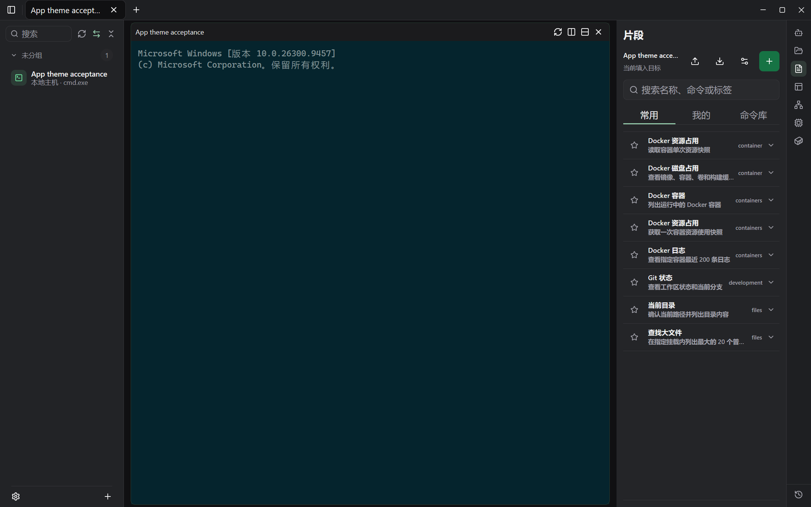

Kerminal 是一个本地优先的桌面终端和远程运维工作台。围绕明确的主机、Tab 与 Pane，把本机与远程终端、SFTP、Docker/Podman、Compose、tmux、SSH 隧道、服务器信息和 Agent 会话组织在同一个窗口里。

`main` 是使用 Rust、GPUI 与 GPUI Kit 重建的 **0.4 原生桌面版本**；[tauri 分支](https://github.com/kongweiguang/Kerminal/tree/tauri) 保留 0.3.x Tauri 实现。新版本不再使用旧版的 WebView / xterm.js 界面，开发也不需要先启动 Node.js 前端。

> **当前为 beta 测试版，功能迁移与跨平台原生验收仍在进行，请勿用于生产环境。** GPUI 默认使用 `~/.kerminal-gpui`，与旧版 `~/.kerminal` 隔离。下面的截图来自 GPUI 开发版隔离窗口，使用演示数据，均保留完整应用窗口，仅遮盖必要的本机信息；首图为真实 Codex CLI 已进入会话的画面。不是 Tauri 版截图，也不代表全功能验收通过。

## 当前能力

| 领域 | GPUI 版能力 |
| --- | --- |
| 连接 | Local、SSH、独立 SFTP、RDP、Telnet、Serial；SSH 支持密码、私钥、SSH Agent、代理与有序跳板。 |
| 终端工作区 | 多 Tab、多级分屏、标签分组与拖拽排序、批量发送、搜索、选择复制、命令块、日志与重连。 |
| 命令辅助 | 命令、参数、路径与历史建议，命令片段、变量填充、预览及命令历史查询。 |
| 文件与传输 | 本机 / SFTP 双端浏览、多主机标签、独立传输标签、队列与进度、取消 / 重试、冲突处理及文本编辑。 |
| 容器 | SSH 宿主上的 Docker、Podman 与 Compose；容器详情、日志、监控、交互终端和容器文件。 |
| 远程工具 | 本机 / SSH tmux、SSH 本地 / 远端 / SOCKS 转发、服务器资源与进程信息。 |
| Agent | Codex、Claude、PI Agent 与自定义 CLI；按 Tab 保留助手界面和历史，支持新建、继续、重命名及归档。 |
| MCP | Streamable HTTP；后台终端、SSH 命令、传输队列、端口转发、历史、配置校验与加密凭据入口。 |
| 配置与桌面 | 文件化配置、加密 Vault、Git 配置同步、浅色 / 深色 / 跟随系统、独立应用与终端配色、快捷键及数据迁移。 |

协议、远端工具和系统客户端各有前置条件；能力入口存在不等于所有平台及异常场景均已验收。当前没有 macOS 真实桌面验收结果，Windows / Linux 的分项验证不能替代它。

## 下载与安装

前往 [GitHub Releases](https://github.com/kongweiguang/Kerminal/releases) 选择 **GPUI beta**，不要用只指向稳定版的 `releases/latest` 判断 0.4 版本。当前 `v0.4.0-beta.5` 的下载入口：

| 平台 | 安装包 |
| --- | --- |
| Windows x64 | [NSIS 安装程序](https://github.com/kongweiguang/Kerminal/releases/download/v0.4.0-beta.5/kerminal_0.4.0-beta.5_x64-setup.exe)（当前用户安装） |
| Linux x64 | [AppImage](https://github.com/kongweiguang/Kerminal/releases/download/v0.4.0-beta.5/kerminal_0.4.0-beta.5_x86_64.AppImage) / [DEB](https://github.com/kongweiguang/Kerminal/releases/download/v0.4.0-beta.5/kerminal_0.4.0-beta.5_amd64.deb) |
| macOS Apple Silicon | [DMG](https://github.com/kongweiguang/Kerminal/releases/download/v0.4.0-beta.5/Kerminal_0.4.0-beta.5_aarch64.dmg) |
| macOS Intel | [DMG](https://github.com/kongweiguang/Kerminal/releases/download/v0.4.0-beta.5/Kerminal_0.4.0-beta.5_x64.dmg) |

- 下载后可对照同一 Release 的 [`SHA256SUMS.txt`](https://github.com/kongweiguang/Kerminal/releases/download/v0.4.0-beta.5/SHA256SUMS.txt) 校验文件。
- 当前 beta 为未签名构建，Windows 可能提示 SmartScreen，macOS 可能被 Gatekeeper 拦截；请先核实下载来源，不要全局关闭系统保护。
- **本 beta 未配置更新器签名与更新 feed，不会自动更新。** 后续测试版请从 Releases 手动下载。
- Linux AppImage 仍依赖宿主的 glibc 和图形环境；当前 DEB 的基础要求为 glibc 2.35 及相应图形运行库。
- GPUI 与旧版使用相同产品安装身份；**数据目录隔离不等于安装包隔离**，安装 GPUI 可能覆盖原安装。试用前备份旧版数据；需要保留旧安装时优先从源码运行。

## 快速开始

### 1. 添加主机或打开本地终端

点击左栏底部的添加按钮，选择连接类型并填写信息；也可以直接点击标签栏的 `+` 打开默认本地终端。

- 左栏单击主机只选择，双击或按 Enter 才连接；同一主机可以打开多个独立终端。
- SSH 首次连接先核对服务端指纹。密码、私钥口令与代理凭据进入加密 Vault，主机配置只保存引用。
- 本地主机可从 Profile 复制 Shell、参数、工作目录与环境；保存后是独立连接，修改模板不会重写已保存主机。
- 独立 SFTP 只提供文件能力，不提供 Shell、tmux、容器或隧道；Telnet / Serial 使用原生协议适配，RDP 交给对应平台客户端，不嵌入远程桌面画面。

保存连接与发起连接是两个明确动作；修改设置不会自动向远端执行命令。

### 2. 组织终端与分屏

使用终端页头的向右 / 向下分屏按钮创建 Pane，右键可选择其它主机。标签支持分组、重命名、折叠与拖动；分组折叠不停止里面的终端。

搜索、复制、日志、命令建议和命令块均作用于明确的终端。批量发送前显式选择目标 Pane，避免将命令发到错误机器。打开终端 URL 时，Windows / Linux 使用 `Ctrl` 点击，macOS 使用 `Command` 点击；普通点击仍用于选择文本。

### 3. 启动 Agent

点击右侧 Agent 工具，选择启动器，再点击“进入”。**选择启动器本身不会启动 CLI。**

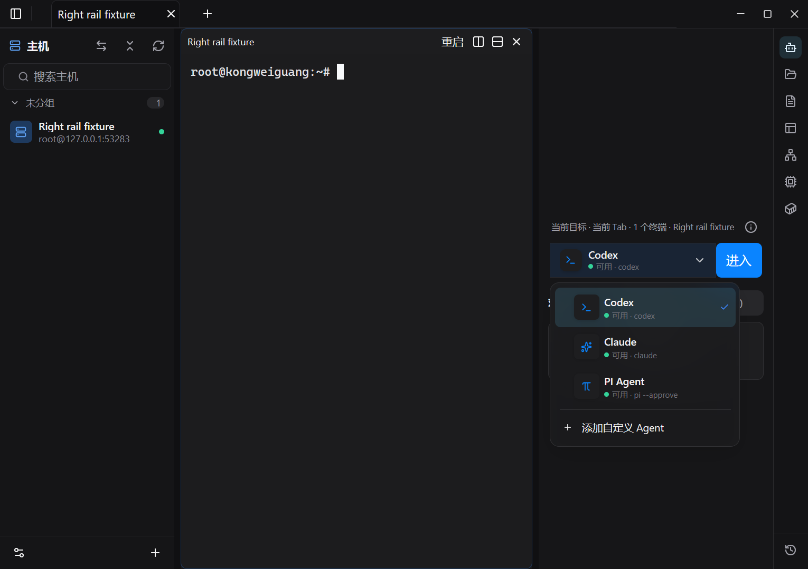

| 启动器 | 本机前置条件 |
| --- | --- |
| Codex | 已安装 `codex` CLI，并完成相应账号登录。 |
| Claude | 已安装 `claude` CLI，并完成相应账号登录。 |
| PI Agent | 已安装支持原生 MCP 的 `pi` CLI，并完成对应模型配置。 |
| 自定义 Agent | 保存可执行命令；命令以明文进入 `settings.toml`，不要填写密码、API Key 或 token。 |

Kerminal 管理 CLI 启动、原生终端展示、会话工作目录和上下文，不代替 Agent 服务商的安装、登录或模型配置。内置 Codex / Claude 默认使用完整权限启动模式；运行前应了解所选 CLI 的权限设置。

每个 Tab 保留自己的助手界面和历史；Agent 可以访问整个 Kerminal，启动时的终端只是首选目标，不是权限边界。普通切换 Tab 不会重绑目标；显式继续或绑定时才更新，失效目标不会自动转投其它终端。删除 Kerminal 中的本地会话记录不会删除服务商侧历史。

### 4. 按需安排工具面板

右侧工具提供 Agent、文件、命令片段、tmux、端口、系统信息、容器和命令历史。工具目标由实际 Tab / Pane 上下文决定，不会仅因左栏选中另一台主机就悄悄切换。

右击工具栏，或聚焦后按 `Shift+F10`，可调整显示、顺序、底部固定，以及右侧、左侧、底部和自由浮窗四种打开位置。窄窗口会临时使用抽屉，不覆盖保存的布局。

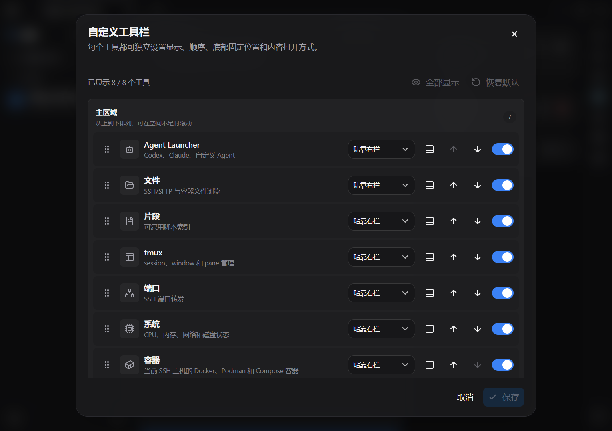

## SFTP、传输与文件编辑

文件工具可以作为跟随当前终端的紧凑浏览器，也可以打开中央双端传输工作台。左右两侧独立选择主机与目录，支持多个主机标签；独立传输 Tab 可以保存自己的双端目标和路径。

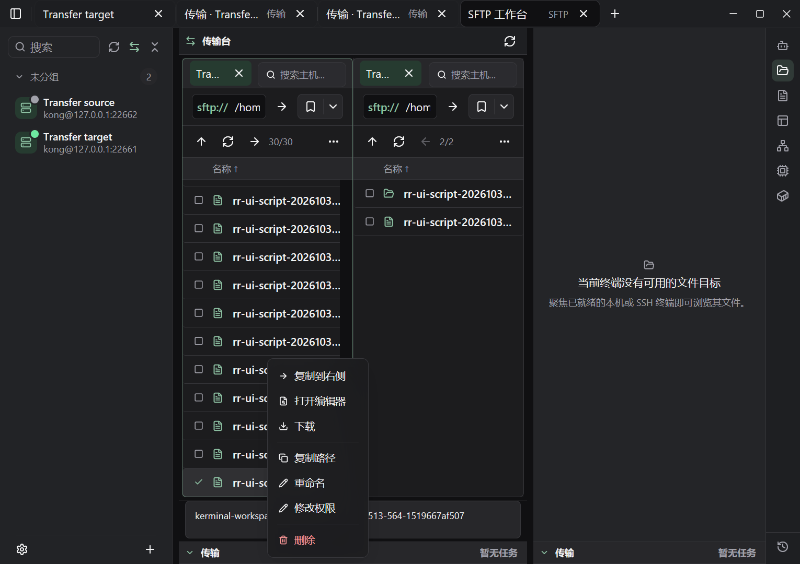

- 本机与远端、远端与远端的文件 / 目录复制，共用传输队列与进度。
- 支持取消、显式重试、冲突改名 / 覆盖；具备可信恢复条件的传输可从断点继续。
- 支持列表 / 树形浏览、隐藏文件、路径书签、新建目录、重命名、权限与删除操作。
- 右侧文件栏与中央传输工作台分别保留浏览状态，切换终端不会覆盖另一处的目录。
- 本机、SFTP 与容器文本通过原生编辑器打开；保存前核对 revision，冲突或提交结果未知时先读回，不盲目覆盖或自动重放。

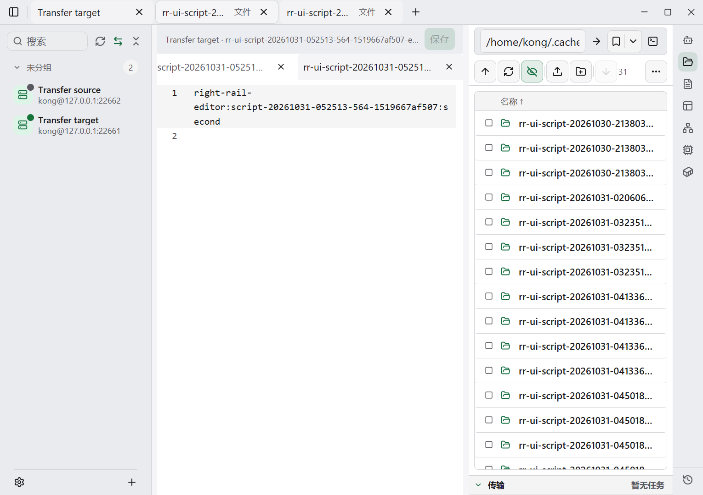

## 容器与 Compose

连接 SSH 主机后，从右侧容器工具管理对应宿主的 Docker / Podman。容器 Pane 继续关联创建它的 SSH 宿主，不从终端文字猜测目标。

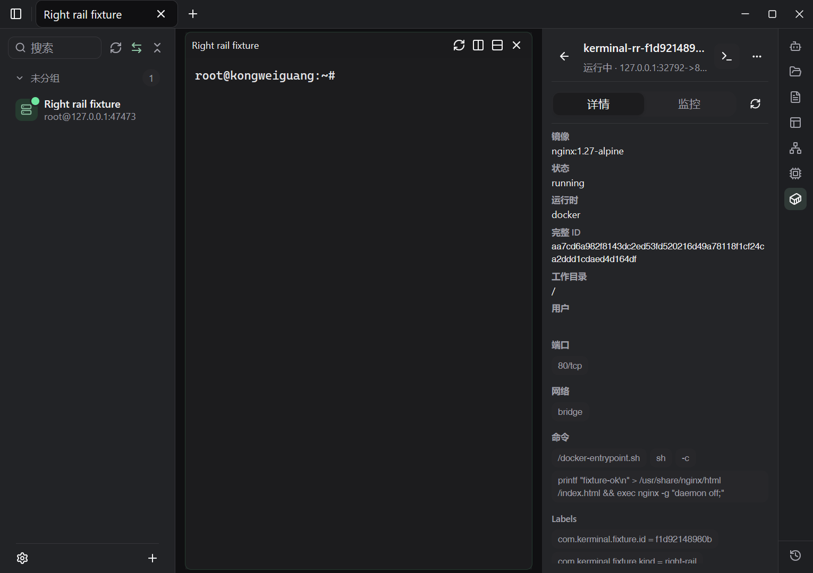

容器列表可按 Compose 项目组织，查看详情、日志与 stats，执行启动、停止、重启及删除，或进入交互终端。Compose 提供项目操作与 YAML 预览；容器内文件浏览和传输复用统一文件服务与队列。

需要远端已安装相应运行时并具备访问权限。右栏容器入口依赖 SSH 宿主；本机终端、独立 SFTP、RDP、Telnet 与串口不因此获得容器能力。危险操作保留明确目标与确认，取消请求也不等于远端命令已经撤销。

## 服务器信息、SSH 隧道与 tmux

服务器工具按“概览、资源、进程”组织信息，支持手动刷新与间隔采样。CPU、内存、磁盘、网络和运行时间来自目标机；GPU / NPU 指标依赖目标机可用的探测工具，不是长期指标存储服务。

tmux 工具面向明确的 Local / SSH 目标，提供会话查看、创建、连接、重命名、分离与结束，并保留常用命令速查。

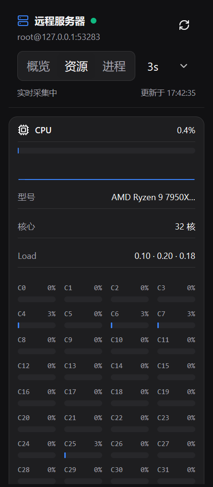

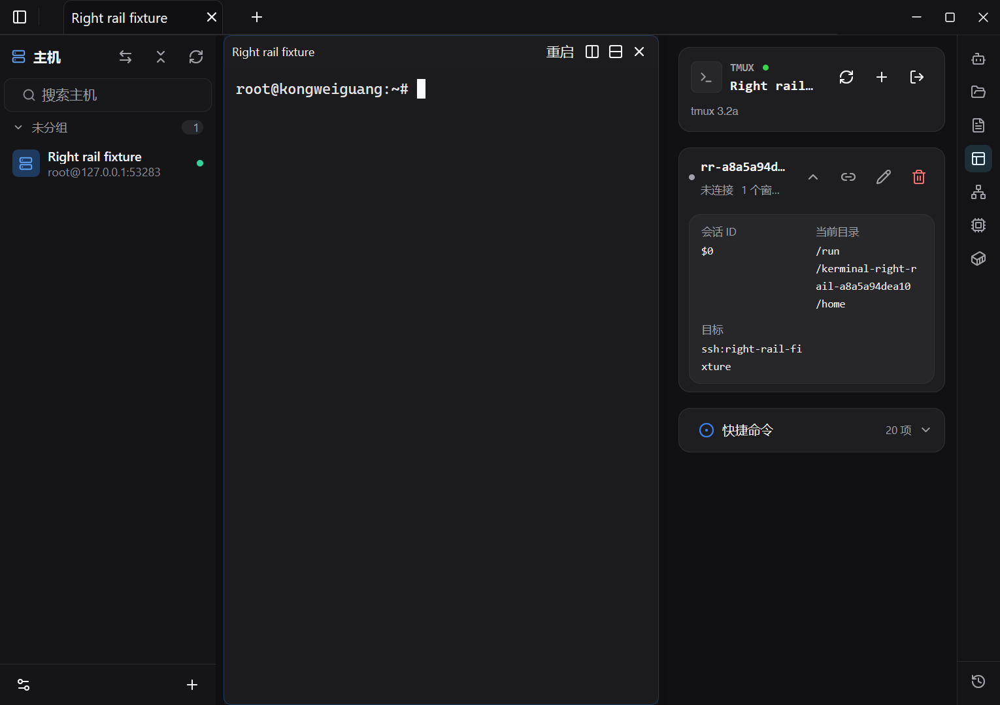

SSH 隧道按访问远端服务、暴露本机服务和 SOCKS 场景组织，支持本地 / 远端端口转发、本地 / 远端动态代理，以及显式启停和代理环境应用。

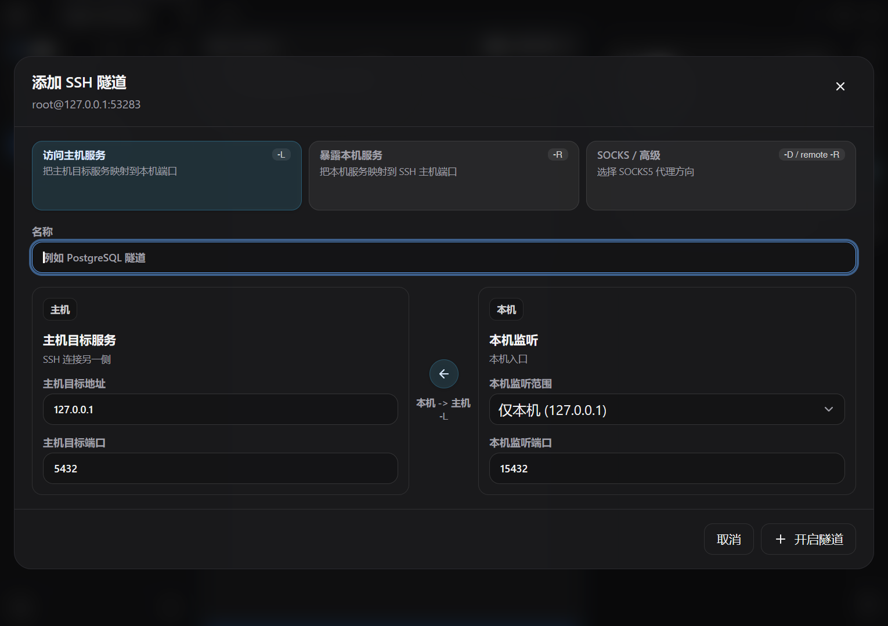

## Agent 与外部 MCP 接入

Kerminal MCP 使用 Streamable HTTP，默认本机地址为 `http://127.0.0.1:37657/mcp`。在设置的 MCP 页启动服务，并以该实例显示的**实际连接配置**为准；端口可修改，停止服务或改变地址后客户端需要重新连接。

支持该配置格式的 MCP host 可使用：

```json
{
  "mcpServers": {
    "kerminal": {
      "type": "http",
      "url": "http://127.0.0.1:37657/mcp"
    }
  }
}
```

推荐调用流程：

1. 调用 `kerminal.help` 了解应用、配置与操作流程，或查询具体工具 schema；实际可调用目录以 `tools/list` 为准。
2. 用 `kerminal.runtime_snapshot` / `terminal.list` 发现运行态。受管 Agent 可用 `kerminal.agent.target_context` 刷新首选目标。
3. 外部客户端执行非交互 SSH 命令使用 `ssh.command`；需要本地、持续或交互 Shell 时，调用 `terminal.create` 创建**后台 PTY**，后续操作显式传递返回的 `sessionId`，结束后关闭。
4. 按需使用 `sftp.transfer.*`、`port_forward.*`、`history.search` 和配置校验。容器、tmux 与系统查询可通过 SSH 命令执行；UI 入口不等于存在同名 MCP 工具。

外部客户端不必先打开终端 Tab；只有用户明确要求操作指定可见终端时才使用它。后台失败不会自动转用可见 Tab，失效目标也不会换成其它会话。0.3.x 的工具目录不能直接当成 0.4 契约，当前定义见 [`tool_catalog.json`](crates/kerminal-mcp/resources/tool_catalog.json)。

工具审批、权限与审计由 MCP host 负责。局域网监听需显式开启，非回环请求使用 Vault 中的 Bearer token；当前 HTTP 不加密传输，只应在可信网络内使用，不能直接暴露到公网。

## 设置与配置工作区

设置覆盖界面外观、终端、Profile、关键词高亮、命令提示、SFTP、外部启动、MCP、同步、通知、快捷键与关于。应用配色与终端色盘相互独立，支持浅色、深色、跟随系统，以及背景图片和透明度配置。

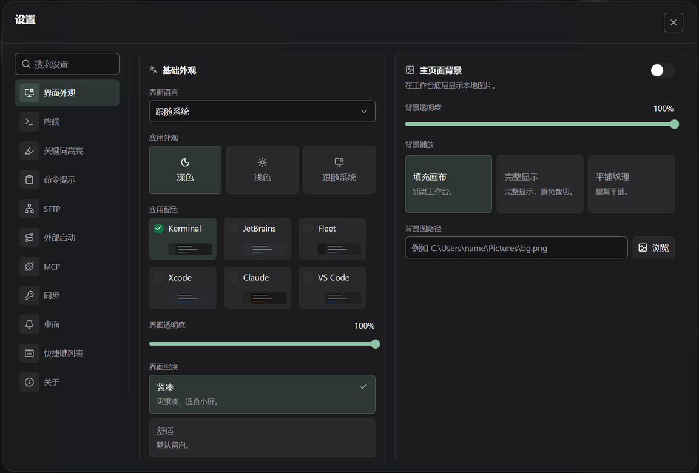

<details>
<summary>查看浅色设置截图</summary>

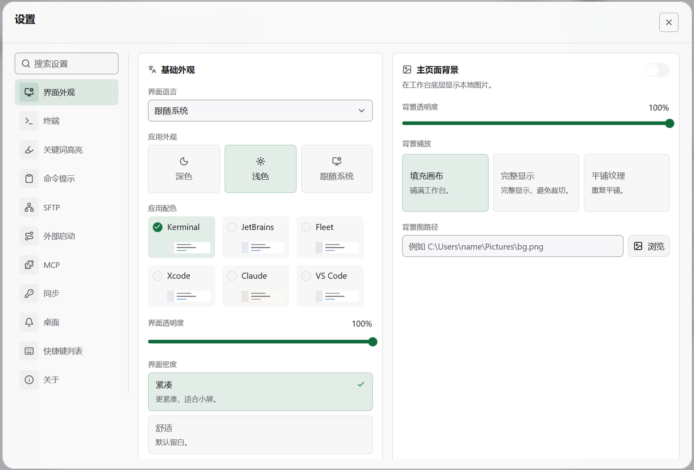

</details>

长期配置保存在当前数据根：

```text
settings.toml
profiles/*.toml
hosts/groups.toml
hosts/*.toml
snippets/*.toml
workflows/*.toml
```

完整字段、示例与关联校验以 [`config-guide.md`](crates/application/resources/config-guide.md) 为准，应用工作区生成的 `kerminal-config.md` 与它同源。

- 配置文件可由用户或获准的 Agent 直接编辑，完成后运行 `kerminal.config.validate`；MCP 不提供通用配置 CRUD。
- 普通设置按 revision 检测并发修改；冲突保留草稿，提交结果未知时先读回核实。
- 密码、私钥口令及敏感环境进入加密 Vault；普通 TOML 只保存引用。`secrets/vault-key.toml` 是本机解密密钥，不提交到 Git、同步、聊天或日志。
- Workspace Sync 使用 Git 同步可移植配置，排除本机密钥、备份与恢复材料；同步不会让两个正在运行的实例共享会话。
- 外部启动接受 `kerminal://`，并可解析 SSH / SFTP URL 和受支持客户端的启动参数；安装包只登记应用自有 scheme，不接管系统通用 `ssh://` / `sftp://` 关联，也不代表第三方厂商官方集成。

## 从 0.3.x 导入与数据迁移

**试用时保留旧目录，不把 GPUI 直接指向真实的 `~/.kerminal`。** debug / release 默认都使用 `~/.kerminal-gpui`，单实例身份按数据根隔离，可以与旧版数据实例并存。

导入已有连接时，只将旧根的主机 / 分组、Profile、`known_hosts`、加密 Vault 及配套 key 复制到新根，并在**新根**完成迁移。保留 key 原访问权限，不转换成明文；旧会话、历史数据库、Git 仓库和运行态不随这次连接导入复制。两个目录之后独立保存，不自动同步。

0.4 正常业务只读写当前格式；旧数据转换集中到一次性迁移用例。普通启动与独立 `kerminal-migrate` helper 共用转换逻辑，按格式标记和实际结构预检，提供备份、校验、幂等重试与中断恢复；损坏或未来版本的数据保留原文件并报告原因。

<details>
<summary>手动预检与迁移入口</summary>

先退出使用待迁移目录的全部新旧实例。安装包把 helper 与脚本放在资源根的 `migration/` 下；从该资源根运行下面的示例，并将路径换为**已备份的待迁移副本**：

```powershell
& .\migration\kerminal-migrate.ps1 -Root 'C:\path\to\config-copy' -DryRun
& .\migration\kerminal-migrate.ps1 -Root 'C:\path\to\config-copy' -Apply
```

Linux / macOS 对应 `migration/kerminal-migrate.sh`，使用 `--root /path/to/config-copy --dry-run` 预检，明确提交时改为 `--apply`。脚本只调用同目录随包 helper，资源是否随具体安装包交付以包内文件为准。

预检不写数据。成功后不要再让旧版直接读写该目录；迁移前备份保存在 `.kerminal-migration/<operation-id>/`。提交结果未知时保留整个操作目录，由同一入口读回恢复，不能盲目重放或删除备份。开发验收只使用独立临时根，不自动迁移真实用户数据。

</details>

## 源码开发

准备 Git、[Rust 工具链](rust-toolchain.toml) 指定的 **1.98.0**、`rustfmt`、`clippy` 和平台原生构建依赖。Windows 使用 MSVC C++ 构建工具与 Windows SDK；Linux 需要图形、字体及系统开发库，完整安装清单可参考 [原生构建工作流](.github/workflows/gpui-release.yml)。打包脚本另外需要 Python 3.11+。

```powershell
git clone --branch main https://github.com/kongweiguang/Kerminal.git
Set-Location Kerminal
cargo xtask run
```

也可直接运行 `cargo run -p kerminal-desktop`。两种普通开发入口均默认使用 GPUI 数据根。需要隔离运行时，在 PowerShell 中显式指定：

```powershell
$env:KERMINAL_CONFIG_ROOT = Join-Path $PWD 'target/kerminal-local-config'
cargo run -p kerminal-desktop
```

`cargo xtask smoke` 默认使用 `target/kerminal-native-smoke`。`run` / `smoke` 都支持用绝对路径 `KERMINAL_DEV_CONFIG_ROOT` 优先覆盖配置根；并行工作时再用 `CARGO_TARGET_DIR` 隔离构建产物，避免占用正在运行的二进制。

### 常用验证

| 命令 | 用途 |
| --- | --- |
| `cargo xtask architecture` | 检查模块边界与依赖方向。 |
| `cargo xtask fmt` | 检查 Rust 格式，不自动改写文件。 |
| `cargo xtask check` | 检查 workspace 与全部目标。 |
| `cargo xtask clippy` | 严格 Clippy 检查。 |
| `cargo xtask test` | 运行 workspace 测试。 |
| `cargo xtask ci` | 统一架构、格式、Clippy 与测试门禁。 |
| `cargo xtask smoke` | 使用隔离数据根启动原生 smoke。 |
| `cargo xtask source-fingerprint` | 输出当前源码树 SHA-256 JSON。 |

测试通过只证明对应范围；真实连接、窗口交互、安装升级与性能要分别验证，不能用命令存在、编译成功或后端 PTY 指标代替原生验收。

### 工作区结构

```text
crates/
  domain/             领域实体与不变量
  application/        用例、端口与生命周期编排
  terminal/           独立终端解析引擎与数据契约
  infrastructure/     存储、连接、进程和平台适配
  kerminal-ui/        GPUI / GPUI Kit 界面
  kerminal-mcp/       面向 MCP host 的协议适配
  kerminal-desktop/   桌面组合根与启动入口
xtask/                开发、质量门禁与交付命令
```

<details>
<summary>本地打包与发布入口</summary>

从仓库根目录安装固定版工具到仓库私有目录，并显式选择 target；以下为 Windows x64 示例：

```powershell
$target = 'x86_64-pc-windows-msvc'
cargo install cargo-about --version 0.9.2 --locked --features cli --root target/tools/cargo-about
cargo install cargo-packager --version 0.11.8 --locked --root target/tools/cargo-packager
$env:PATH = (Resolve-Path 'target/tools/cargo-packager/bin').Path + [IO.Path]::PathSeparator + $env:PATH
cargo +1.98.0 build --locked --release -p kerminal-desktop --target $target
cargo +1.98.0 xtask package --target $target
```

`package` 不代替 release build：先验证私有 `cargo-about` 与第三方许可证报告，再运行 cargo-packager、收集实际产物。缺失工具、版本不符或报告不完整都会停止打包。

平台配置位于 [`packaging/`](packaging/)，资源路径相对配置目录解析。原始产物先进入 `target/package-output/`，整理后位于 `target/package-candidates/<target>/`：Windows 为 NSIS，Linux 为 AppImage / DEB，macOS 为应用包 / DMG；必要的 updater archive 单独生成，不以改扩展名替代真实打包。

支持的 target 为 `x86_64-pc-windows-msvc`、`x86_64-unknown-linux-gnu`、`x86_64-apple-darwin`、`aarch64-apple-darwin`。[候选打包工作流](.github/workflows/gpui-package.yml) 可手动触发；[beta 发布工作流](.github/workflows/gpui-release.yml) 核对 `vX.Y.Z-beta.N` tag 与 workspace 版本，构建四个平台并发布 prerelease 及摘要，不等于正式版签名或安装验收。发布说明由 `packaging/release_notes.py` 按上一个发布 tag 到当前 tag 的提交生成“新功能 / 改进 / 修复”分节，`chore` 提交不对外展示。

稳定候选应同时记录构建前后源码指纹与实际二进制摘要。源码指纹覆盖锁文件和非忽略的新源码，但单独的 Git revision 或指纹不能证明二进制与源码的对应关系。

</details>

<details>
<summary>原生窗口性能采集</summary>

同时启用 `acceptance-metrics` feature 与环境开关；默认先预热 5 秒，下面采集 60 秒。输出必须是绝对路径，且不能覆盖已有文件：

```powershell
$env:KERMINAL_CONFIG_ROOT = Join-Path $PWD 'target/acceptance/native/config'
$env:KERMINAL_ACCEPTANCE_METRICS = '1'
$env:KERMINAL_ACCEPTANCE_METRICS_DURATION_MS = '60000'
$env:KERMINAL_ACCEPTANCE_METRICS_OUTPUT = Join-Path $PWD 'target/acceptance/native/frames.json'
cargo run --locked --release -p kerminal-desktop --features acceptance-metrics
```

采集期间需要实际操作窗口。报告保留测量区间、样本数、直方图与 p95；样本不足时不能宣称性能通过。记录硬件、字体、DPI、窗口尺寸及构建模式；GPUI 提交 / 输入处理耗时不等于屏幕显示时刻，也不等于 PTY 回显延迟。本段仅说明采集入口，不提供未经实测的性能结论。

</details>

## 开源协议

Kerminal 以 **GNU General Public License v3.0 or later（GPL-3.0-or-later）** 授权，详见 [LICENSE](LICENSE)。第三方依赖及随包资源说明见 [THIRD_PARTY_NOTICES.md](THIRD_PARTY_NOTICES.md)。
