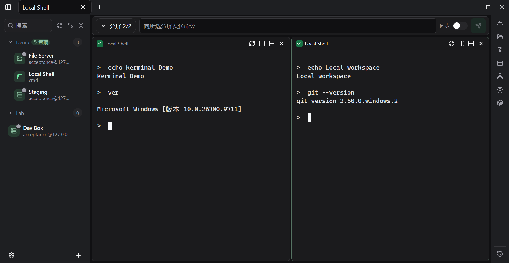
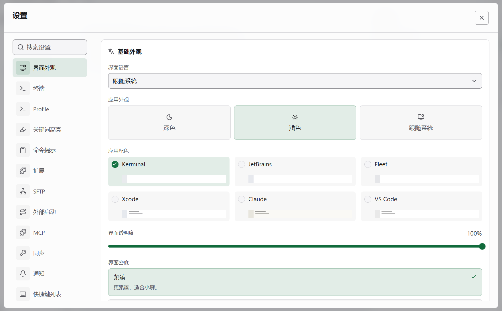

<!-- @author kongweiguang -->

<div align="center">
  
  <h1>Kerminal</h1>
  <p><strong>在一个桌面工作台里，用本机终端、连远程主机、传文件。</strong></p>
  <p><a href="https://github.com/kongweiguang/Kerminal/releases/latest">下载最新版</a> · <a href="#快速开始">快速开始</a> · <a href="README.en.md">English</a></p>
</div>



Kerminal 是用 Rust、GPUI 和 GPUI Kit 构建的原生终端应用。你可以在标签和分屏里并行操作多个会话，再从工具栏打开文件、容器或 Agent。

<sub>Windows 原生窗口实拍，使用演示数据。</sub>

## 下载与安装

从 [GitHub Releases](https://github.com/kongweiguang/Kerminal/releases/latest) 下载对应平台的安装包。

| 平台 | 安装包 |
| --- | --- |
| Windows x64 | `.exe` 安装程序，按当前用户安装 |
| Linux x64 | `.AppImage` 或 `.deb` |
| macOS | Apple Silicon 或 Intel 版 `.dmg` |

Windows 安装程序未做 Authenticode 签名，macOS 安装包未做公证。遇到系统提示时，可先用发布页的 `SHA256SUMS.json` 核对下载文件。Linux 需要系统图形运行库，`.deb` 要求 glibc 2.35 或更高。macOS 安装和桌面交互仍待实机验收。

**从 0.3.x 升级。** 安装前完全退出旧版（包括托盘进程），并备份原数据目录。0.4 正式版首次启动会检查并迁移 `~/.kerminal` 中受支持的旧格式。保留 `.kerminal-migration/` 下的备份，旧版无法读取迁移后的数据。开发版和 Beta 的 `~/.kerminal-gpui` 不会自动合并。

## 快速开始

1. **开终端。** 点击标题栏 `+` 打开本机 Shell。要连接服务器，在左侧主机栏添加 SSH 主机，再双击主机打开会话。
2. **并排操作。** 用终端页头的分屏按钮向右或向下拆分。右键点击分屏按钮，可为新分屏选择另一台主机。
3. **打开会话工具。** 从右侧工具栏打开文件、容器或服务器信息。例如，连接 SSH 后可以打开文件面板查看远程目录，也可以从主机栏进入双端文件工作台，在本机和远端之间传输文件。

## 工作台能做什么

- **管理终端和连接。** 用标签和多级分屏组织本机、SSH、独立 SFTP、Telnet 和串口会话。RDP 由系统客户端打开。SSH 支持密码、私钥、SSH Agent、代理与多级跳板。
- **传输和编辑文件。** 在侧栏浏览当前会话的文件，或在双端工作台选择源和目标。传输可取消、重试并处理同名冲突。内置编辑器可以打开本机、SFTP 和容器中的文本文件。
- **查看和管理远端服务。** 通过 SSH 查看服务器资源和进程，管理 Docker、Podman 和 Compose，查看容器日志或打开容器终端。也可以管理 tmux 会话和 SSH 端口转发。可用操作取决于连接类型、远端工具和账号权限。
- **把常用操作留在手边。** 搜索终端输出、回查命令历史、保存带变量的命令片段，或向明确选中的分屏批量发送输入。
- **按自己的习惯配置。** 外观可选浅色、深色或跟随系统，应用配色和终端色盘独立设置。支持自定义快捷键、Shell Profile、TOML 配置、加密 Vault 和 Git 配置同步。见[配置指南](crates/application/resources/config-guide.md)。

<details>
<summary>查看浅色外观与配色设置</summary>



</details>

## AI Agent、MCP 与扩展

**在终端旁使用 Agent。** 先安装并配置对应 CLI，再从右侧 Agent 面板启动 Codex、Claude Code、PI Agent 或自定义 CLI。切换标签会保留原来的 Agent 目标。可在终端设置中选择把 Agent 命令发往后台终端。内置 Codex 和 Claude Code 默认以完整权限启动。

**接入外部 MCP 客户端。** 首次使用时，在「设置 → MCP」点击「启动」，再复制连接配置。手动启动会记住自动启动偏好，点击「停止」可关闭。默认端点为 `http://127.0.0.1:37657/mcp`，使用 Streamable HTTP。连接后调用 `kerminal.help` 查看入口。客户端可创建后台终端、执行 SSH 命令、传输文件和管理转发，权限与审批由客户端宿主管理。局域网模式应仅用于可信网络。见 [MCP 工具定义](crates/kerminal-mcp/resources/tool_catalog.json)。

**安装扩展。** 在「设置 → 扩展」管理插件。插件可以添加连接类型、工作区视图、工具或命令，安装和启停后需要重启。Sidecar 使用当前用户的权限，只启用信任的插件。见[插件目录](https://github.com/kongweiguang/Kerminal/releases/tag/plugins-catalog-v1)和[开发示例](sdk/examples/README.md)。

## 从源码运行

安装仓库锁定的 Rust 工具链和对应平台的开发依赖。见 [Rust 工具链](rust-toolchain.toml)与[构建依赖](.github/workflows/gpui-release.yml)。

```bash
git clone https://github.com/kongweiguang/Kerminal.git
cd Kerminal
cargo xtask run
```

正式版默认使用 `~/.kerminal`，源码运行默认使用 `~/.kerminal-gpui`。可用 `KERMINAL_CONFIG_ROOT` 指定独立目录。运行 `cargo xtask smoke` 可用隔离数据做原生启动检查。

## 开源协议

Kerminal 使用 **GPL-3.0-or-later**。[许可证](LICENSE) · [第三方声明](THIRD_PARTY_NOTICES.md)
